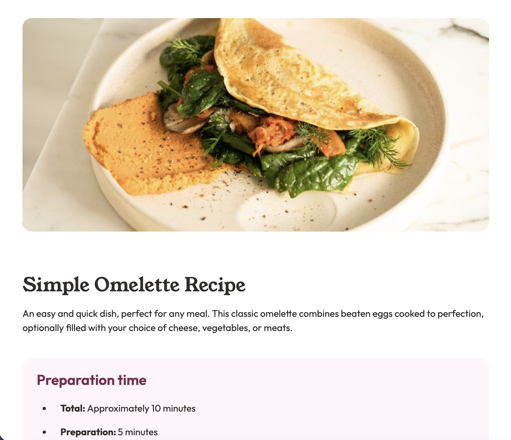

# Frontend Mentor - Recipe page solution

This is a solution to the [Recipe page challenge on Frontend Mentor](https://www.frontendmentor.io/challenges/recipe-page-KiTsR8QQKm).

## Table of contents

- [Overview](#overview)
  - [The challenge](#the-challenge)
  - [Screenshot](#screenshot)
  - [Links](#links)
- [My process](#my-process)
  - [Built with](#built-with)
  - [What I learned](#what-i-learned)
  - [Continued development](#continued-development)
  - [Useful resources](#useful-resources)
  - [AI Collaboration](#ai-collaboration)
- [Author](#author)
- [Acknowledgments](#acknowledgments)

**Note: Delete this note and update the table of contents based on what sections you keep.**

## Overview

### Screenshot




### Links

- Solution URL: [Add solution URL here](https://github.com/OmarReyesC/fm-recipe-page-main)
- Live Site URL: [Add live site URL here](https://omarreyesc.github.io/fm-recipe-page-main/)

## My process

### Built with

- Semantic HTML5 markup
- Vanilla CSS
- Flexbox
- CSS Grid
- Mobile-first workflow

### What I learned

This was the first time I used Agents and Github copilot, so that was very interesting. 
This was also the first time I used the "table" tag and its elements, so I'm proud of that, even if it was in a very limited capacity. 

```html
<table class="nutrition-table">
  <tbody>
    <tr>
      <th scope="row">Calories</th>
      <td>277kcal</td>
    </tr>
    <tr>
      <th scope="row">Carbs</th>
      <td>0g</td>
    </tr>
    <tr>
      <th scope="row">Protein</th>
      <td>20g</td>
    </tr>
    <tr>
      <th scope="row">Fat</th>
      <td>22g</td>
    </tr>
  </tbody>
</table>
```
While on the topic of firsts, I also experimented for the first time with media queries in CSS. 
```css
@media (min-width: 48rem) {
    .image-container {
        padding: var(--space-xl);
    }
}
```

### Continued development

I think I want to continue practicing with screens that adapt to different breakpoints using media queries to further my understanding of the topic. 

### Useful resources

- [A complete CSS grid guide](https://css-tricks.com/complete-guide-css-grid-layout/) - I referred to this extremely useful article to better place my elements using CSS grid. 


### AI Collaboration

- What tools did you use (e.g., ChatGPT, Claude, GitHub Copilot)?
  The tools I used this time were Github Copilot and Gemini. 
- How did you use them (e.g., debugging, generating boilerplate, brainstorming solutions)?
  I used them primarily to understand why some of my CSS wasn't working the way I intended and to research on the use of some tags and syntax. 
- What worked well? What didn't?
  My use of AI was rather limited so everything worked at this time. 


## Author

- Frontend Mentor - [@OmarReyesC](https://www.frontendmentor.io/profile/OmarReyesC)
- Twitter - [@reyesapiens](https://x.com/reyesapiens)
